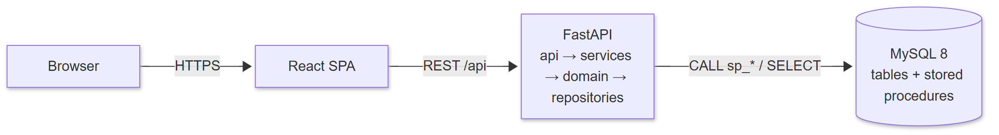
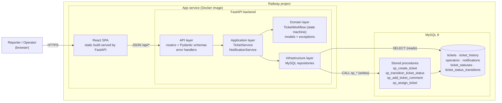

# Solution Architecture

Detailed version: [PNG](diagrams/detailed/architecture.png)

## Layers and responsibilities

| Layer | Location | Responsibility |
|---|---|---|
| Presentation | `frontend/src` | Ticket form, Kanban board, filters, ticket drawer, notifications panel. No business rules: it renders the transitions the API says are allowed. |
| API | `backend/app/api` | HTTP contract: routing, request validation (Pydantic), response mapping and controlled error responses. Controllers only delegate. |
| Application | `backend/app/services` | Use cases: create ticket, change status, comment, assign, notify. Orchestrates domain and repositories. |
| Domain | `backend/app/domain` | `TicketWorkflow` state machine, entities and domain exceptions. Pure Python, no framework or database code. |
| Infrastructure | `backend/app/repositories`, `backend/app/core` | MySQL access through stored procedures, configuration from environment variables, connection handling. |
| Database | `db/` | Schema with foreign keys, the transition table and the stored procedures that change state and write history atomically. |

## Key decisions

- **Defense in depth for the state machine.** The domain layer validates every transition to return fast and clear errors, and `sp_transition_ticket_status` validates it again against the `ticket_status_transitions` table inside a transaction with `SELECT ... FOR UPDATE`. A client that bypasses the API cannot corrupt the workflow. A unit test checks that both rule sets stay identical.
- **Atomic history.** The status update and its `ticket_history` row are written by the same stored procedure in one transaction: either both are persisted or neither is.
- **Immutable trail.** `ticket_history` references `tickets` with `ON DELETE RESTRICT`, so history cannot be orphaned or silently removed.
- **Single deployable.** The React build is served by FastAPI from the same container, so the app has one public URL, no CORS setup in production and a single Railway service plus the MySQL plugin.
- **Configuration by environment.** Connection data comes from `DATABASE_URL` (or Railway's `MYSQL_URL`). No secrets are stored in the repository.
- **Controlled errors.** Domain errors map to `404`, `409` and `422`; invalid payloads return `422` with field details; database outages return `503`. Every error uses the same JSON shape.
