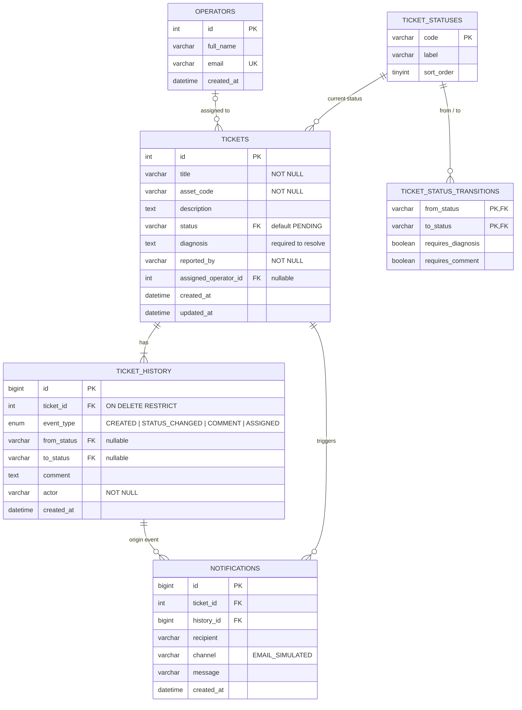

# Data Model

Core relationship: **Ticket (1) — (N) Ticket history**. Every ticket has at least one history entry (`CREATED`), and every status change, comment and assignment adds a new entry.

## Entities

| Table | Purpose |
|---|---|
| `tickets` | Maintenance report and its current state. |
| `ticket_history` | Append-only event log (creation, status changes, comments, assignments). |
| `operators` | People who work on tickets (bonus: assignment). |
| `ticket_statuses` | Catalog of valid statuses. |
| `ticket_status_transitions` | The state machine stored as data; read by `sp_transition_ticket_status`. |
| `notifications` | Simulated e-mail notifications produced on status changes and assignments (bonus). |

## Integrity rules

- `ticket_history.ticket_id → tickets.id` with `ON DELETE RESTRICT`: a ticket with history cannot be deleted and history cannot point to a missing ticket.
- `tickets.status`, `ticket_history.from_status` and `ticket_history.to_status` reference `ticket_statuses.code`, so no unknown status can be stored.
- `tickets.assigned_operator_id → operators.id` with `ON DELETE SET NULL`.
- `notifications` references both the ticket and the history event that produced it.
- `CHECK` constraints reject empty titles and asset codes; `chk_transitions_distinct` rejects self-transitions.
- Indexes on `tickets(status)`, `tickets(created_at)`, `tickets(assigned_operator_id)` and `ticket_history(ticket_id, created_at)` support the board filters and the history timeline.

## Stored procedures

| Procedure | What it does |
|---|---|
| `sp_create_ticket` | Validates input, inserts the ticket as `PENDING` and writes the `CREATED` (and optional `ASSIGNED`) history entries in one transaction. |
| `sp_transition_ticket_status` | Locks the ticket, checks the transition table and the diagnosis/comment requirements, updates the status and writes the `STATUS_CHANGED` entry atomically. |
| `sp_add_ticket_comment` | Adds a `COMMENT` entry; closed tickets are rejected. |
| `sp_assign_ticket` | Assigns an operator and writes the `ASSIGNED` entry; closed tickets are rejected. |

Errors are raised with `SIGNAL` and custom codes that the backend maps to HTTP responses: `5404 → 404`, `5409 → 409` (transition not allowed), `5410 → 409` (conflict), `5422 → 422` (business rule).
