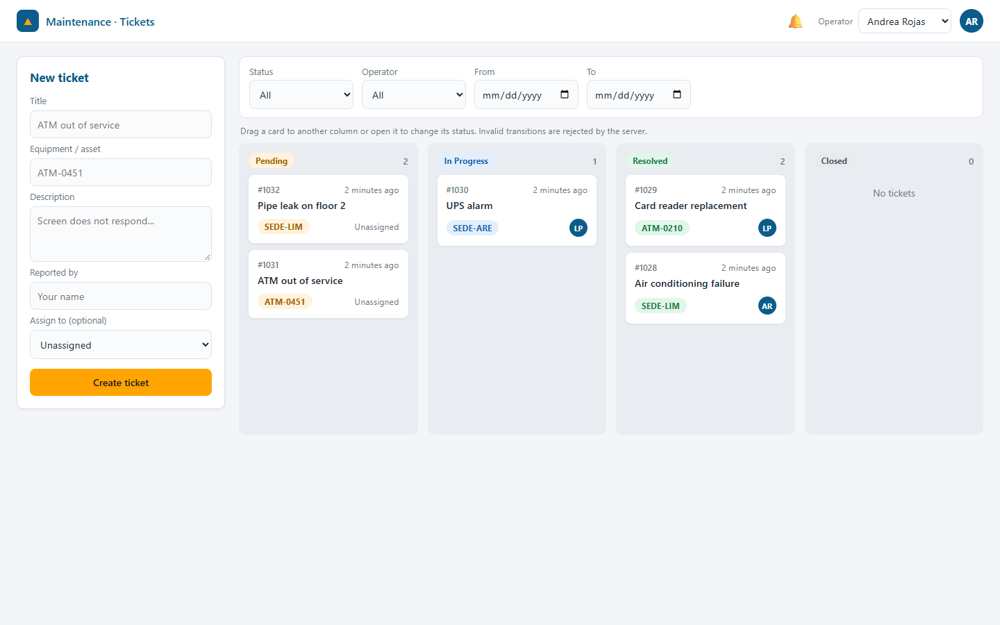
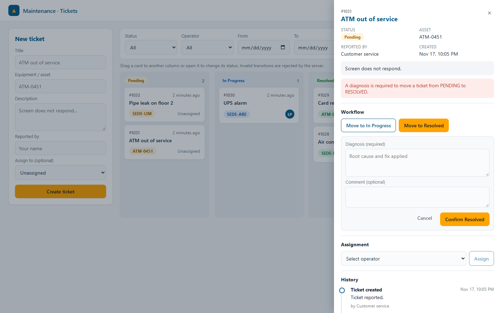
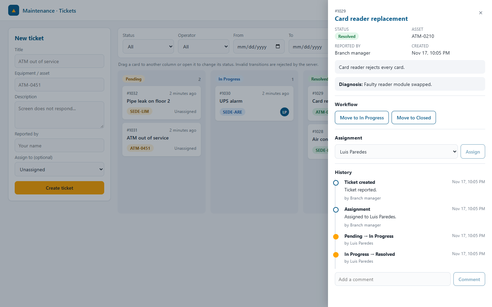
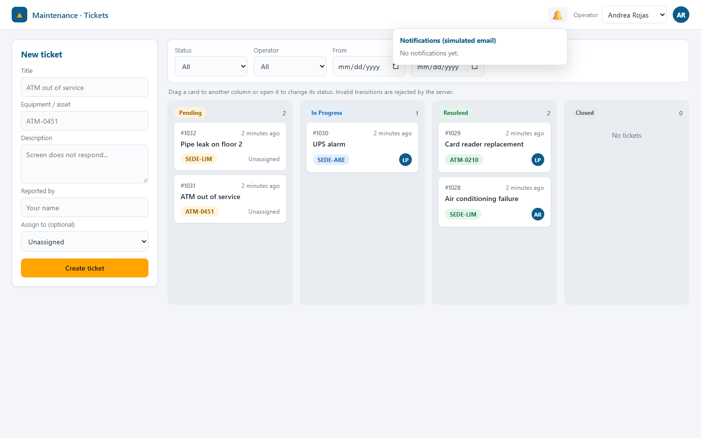
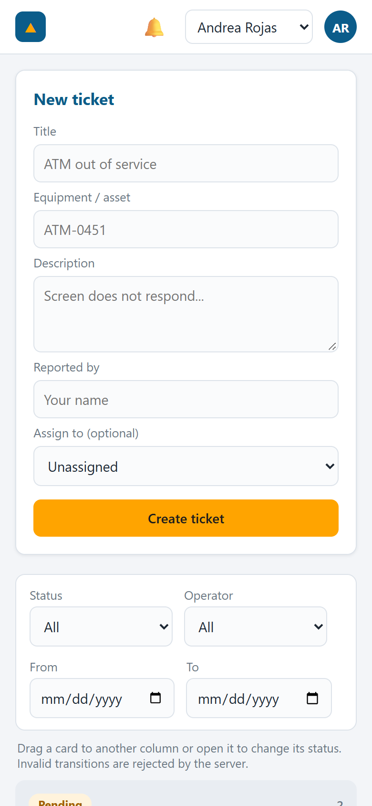

# Interface Prototype

The screens follow the reference prototype (ticket form on the left, status board on the right) with these UX additions:

- A fourth **Closed** column, so finished work leaves the Resolved column.
- Filters by status, operator and creation date range.
- A ticket drawer with workflow actions, assignment, comments and the full history timeline.
- Inline feedback when the server rejects a transition.
- A notifications panel with the simulated e-mails sent on each change.
- Operator selector in the header, used as the actor recorded in the history.

## Board

## Blocked transition (Pending → Resolved without diagnosis)

## Ticket detail and history

## Notifications

## Mobile layout

