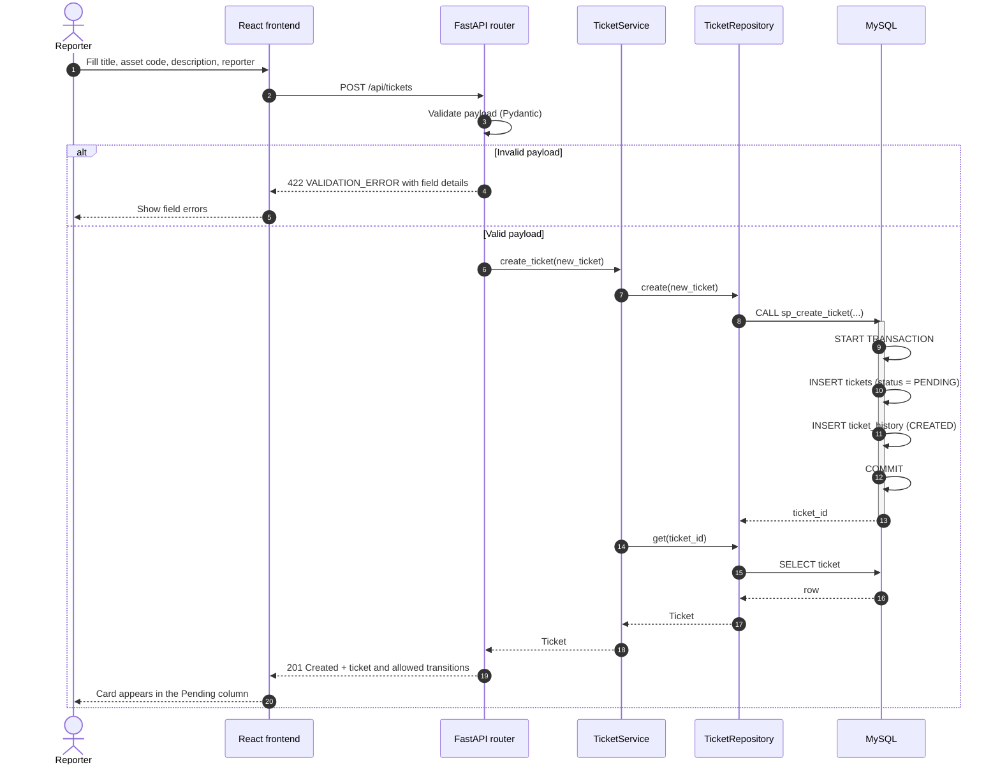
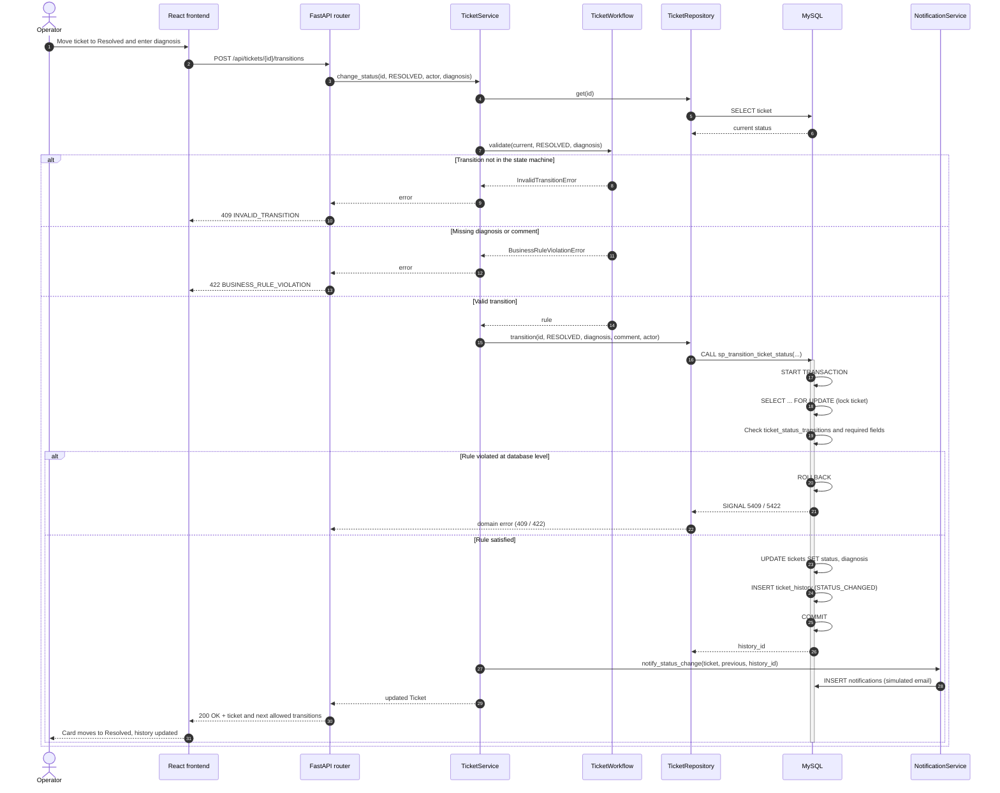
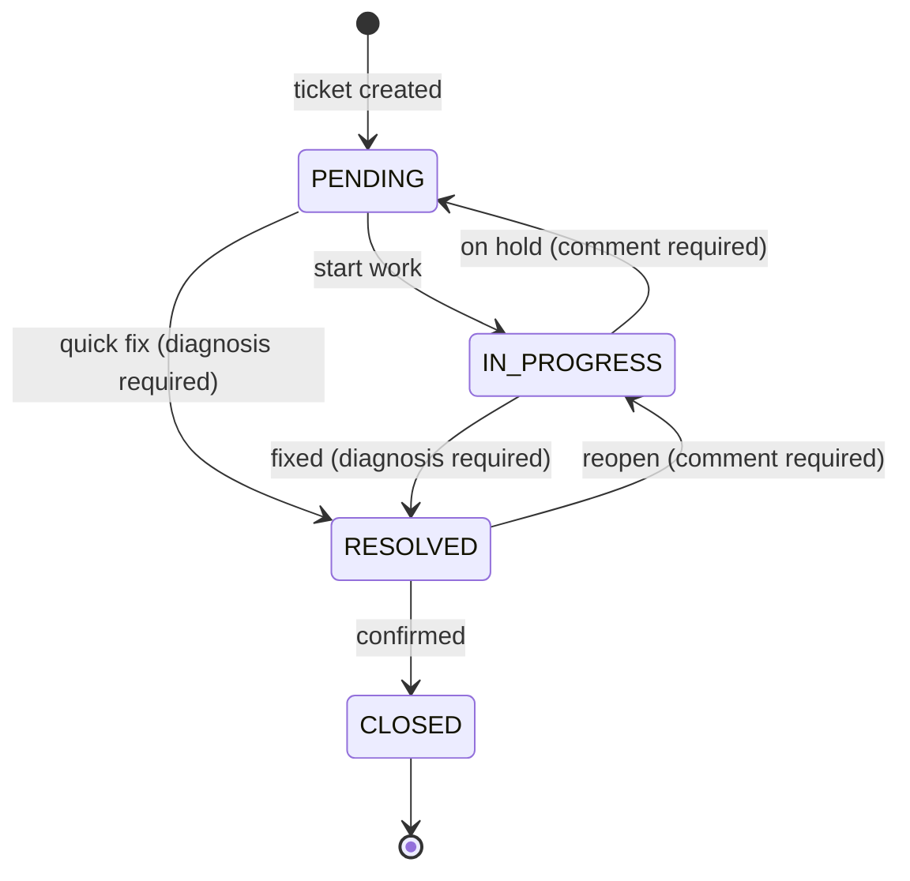

# Sequence Analysis

Main flow: a reporter creates a ticket and an operator moves it through the workflow. Every status change is persisted together with a history entry by a stored procedure.

## 1. Create ticket

## 2. Status transition with history

## State machine

Any pair not shown above (for example `PENDING → CLOSED` or `CLOSED → IN_PROGRESS`) is rejected with `409`.
